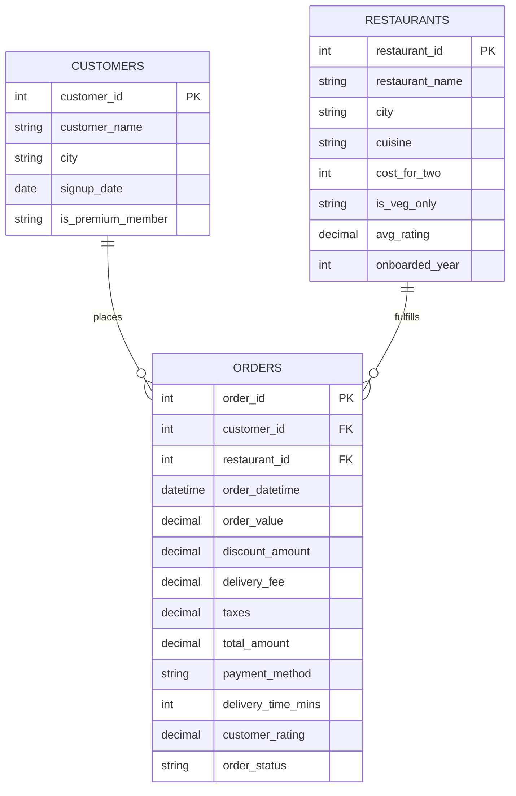

# Zomato Sales Analysis — SQL + Excel Portfolio Project

End-to-end sales analysis of a food-delivery platform, built entirely with **SQL** (schema design, joins, CTEs, window functions) and **Excel** (formula-driven pivot-style summaries, an executive dashboard, and charts). No BI tool, no hardcoded numbers — every metric in the workbook recalculates from the raw order data.

---

## Project Overview

**Business context:** A food-delivery platform (Zomato-style) wants to understand what's driving revenue, where operational problems are hurting the business, and which customers/restaurants matter most — using only the order-level transaction data it already has.

**What this project does:**
1. Models the data as a proper relational schema (`customers`, `restaurants`, `orders`) and answers 18 real business questions in SQL — from basic KPIs to RFM customer segmentation and window-function rankings.
2. Rebuilds the same analysis in Excel as a fully formula-driven workbook (SUMIFS/COUNTIFS/AVERAGEIFS, LARGE + INDEX/MATCH, no pasted values) with a one-page executive dashboard.
3. Surfaces concrete, sometimes counter-intuitive business insights (see below) rather than just re-stating totals.

---

## Tech Stack

| Layer | Tool |
|---|---|
| Data generation | Python (pandas, numpy) |
| Database / analysis | SQL (MySQL 8+ / PostgreSQL 12+ syntax; tested on SQLite) |
| Reporting | Excel (openpyxl-built, formula-driven, native charts) |

---

## Project Structure

```
zomato-sales-analysis/
├── data/
│   ├── zomato_customers.csv        # 2,500 customers
│   ├── zomato_restaurants.csv      # 60 restaurants, 8 cities, 12 cuisines
│   └── zomato_orders.csv           # 9,000 orders, Jan 2023 – Dec 2024
├── sql/
│   ├── 01_schema.sql               # Table DDL, FKs, indexes, load instructions
│   └── 02_business_queries.sql     # 18 queries across 6 analysis sections
├── excel/
│   └── Zomato_Sales_Dashboard.xlsx # 10-sheet formula-driven workbook + dashboard
├── scripts/
│   └── generate_data.py            # Reproducible synthetic data generator (seeded)
├── docs/
│   └── dashboard_preview.png       # Dashboard screenshot (shown above)
└── README.md
```

---

## Entity Relationship Diagram



---

## SQL Analysis (`sql/02_business_queries.sql`)

18 queries organized into 6 sections, using joins, `CASE`, `HAVING`, CTEs, and window functions (`LAG`, `RANK`, `SUM() OVER`):

| Section | Example questions answered |
|---|---|
| **A. KPI Overview** | What's the headline revenue, AOV, and cancellation rate? |
| **B. Revenue & Trend** | Monthly revenue trend, MoM growth %, cumulative revenue, day-of-week & hourly demand |
| **C. City & Cuisine** | Revenue/AOV by city, cuisine performance, delivery time & cancellation rate by city |
| **D. Restaurant Performance** | Top restaurants by revenue, top-rated restaurants, **top 3 per city (window function)**, highest-cancellation restaurants |
| **E. Customer Analysis** | Top customers by lifetime value, repeat vs. one-time customer revenue split, premium vs. non-premium comparison, **RFM segmentation (CTE)** |
| **F. Payments & Discounts** | Payment method mix, does a discount actually increase basket size? |

Every query was executed and validated against the dataset before being written up (see `docs/validated_results.txt` for raw output).

---

## Excel Dashboard (`excel/Zomato_Sales_Dashboard.xlsx`)

| Sheet | Purpose |
|---|---|
| **Dashboard** | One-page executive summary: 5 KPI cards + 4 charts + Top-5 restaurants table |
| **Orders** | 9,000-row fact table with 3 formula-driven helper columns (`TEXT`, `CHOOSE`+`WEEKDAY`, `HOUR`) |
| **KPI_Summary** | Headline metrics via `COUNTIF`/`SUMIF`/formula ratios |
| **Monthly_Trend** | Revenue trend, MoM growth %, running total — feeds the line chart |
| **City_Analysis / Cuisine_Analysis / Payment_Analysis** | Pivot-style breakdowns via `SUMIFS`/`COUNTIFS`/`AVERAGEIFS` |
| **Restaurant_Summary** | Per-restaurant rollup for all 60 restaurants |
| **Top10_Restaurants** | Dynamically pulls the top 10 by revenue using `LARGE` + `INDEX`/`MATCH` — not manually sorted |


---

## Key Business Insights & Recommendations

1. **Growth is real but recent.** Monthly revenue grew from ₹1.6K (Jan 2023) to ₹8.1L (Dec 2024) — cumulative ₹45.6L delivered revenue — with MoM growth accelerating to 25–42% in H2 2024. *Recommendation: investigate what changed operationally/marketing-wise from mid-2024 and double down on it.*

2. **Retention, not acquisition, is paying the bills.** Repeat customers are 79% of the active base but generate **94.2% of revenue**; one-time customers contribute just 5.8%. RFM segmentation shows ~22% of customers are "At Risk / Churned," representing ~₹5.2L in historical revenue exposure. *Recommendation: a win-back campaign targeted at the At-Risk segment is higher-leverage than broad acquisition spend.*

3. **The premium membership isn't earning its keep.** "Gold"-style premium members show almost no lift over regular customers — AOV is only 1.6% higher (₹570.81 vs ₹561.92) and they order *slightly less* often per customer (3.74 vs 3.78). *Recommendation: the loyalty program's perks likely need to be redesigned to actually change behaviour, not just be a discount label.*

4. **Discounts are correlating with smaller baskets, not bigger ones.** Discounted orders average ₹504.52 final value vs. ₹603.77 for full-price orders. *Recommendation: audit whether promotions are attracting price-sensitive small-basket orders rather than driving incremental spend — consider spend-threshold discounts instead of blanket ones.*

5. **Bengaluru is the highest-value city, not the highest-volume one.** Bengaluru generates the most revenue (₹10.35L) with *fewer* orders than Delhi NCR (1,370 vs 1,698), because its AOV is 30% higher (₹756 vs ₹581) — likely a premium cuisine mix (Continental/Italian-heavy). Delhi NCR, meanwhile, has the platform's highest cancellation rate (11.4%) *and* longest average delivery time (37.4 min) — a likely cause-and-effect worth an ops review.

6. **Premium cuisines have a quality gap.** Italian and Continental cuisines drive the highest AOV (₹873 and ₹944) but rate lower on average (3.8–4.1★) than cheaper categories like Street Food (4.12★). Revenue-per-order is high, but satisfaction isn't keeping pace.

7. **Demand is sharply bimodal.** Lunch (12–3 PM) and dinner (7–11 PM) account for the large majority of orders; the platform is nearly idle 3–6 PM. Saturday alone drives ~25% of weekly revenue. *Recommendation: any rider-availability or promo-timing decisions should be built around these two windows, not a flat daily average.*

8. **UPI has become the default rail.** 45.6% of orders and 46% of revenue run through UPI — more than double the next method (cards, 22%) — consistent with broader Indian digital-payments trends. Cash on Delivery still holds 15%, showing real (if shrinking) demand for it.

---

## How to Reproduce

```bash
# 1. Regenerate the dataset (optional — CSVs are already included)
cd scripts
python generate_data.py

# 2. Load into your database of choice
mysql -u root -p your_db < ../sql/01_schema.sql
# then load data/*.csv per the instructions at the bottom of 01_schema.sql

# 3. Run the analysis
mysql -u root -p your_db < ../sql/02_business_queries.sql

# 4. Open excel/Zomato_Sales_Dashboard.xlsx in Excel / LibreOffice Calc
```

---

## Skills Demonstrated

`SQL joins & subqueries` · `CTEs` · `Window functions (LAG, RANK, SUM OVER)` · `Aggregate & conditional aggregation (CASE, HAVING)` · `RFM customer segmentation` · `Relational schema design & indexing` · `Excel formulas (SUMIFS/COUNTIFS/AVERAGEIFS, LARGE, INDEX/MATCH)` · `Dashboard design` · `Data storytelling`